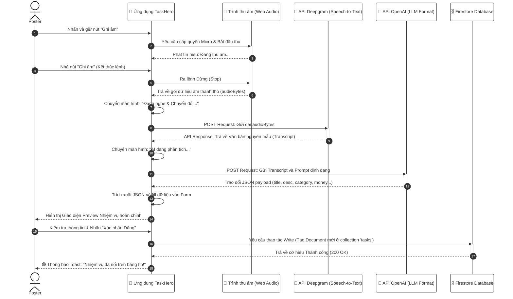

## 3.2. Thiết kế Luồng xử lý (Quy trình Nghiệp vụ)

Để đảm bảo các yêu cầu chức năng (Chương 2) được thiết kế và triển khai chính xác, ứng dụng TaskHero được bóc tách thành **8 module chức năng lõi**. Mỗi module chứa các luồng nghiệp vụ được biểu diễn thông qua Sơ đồ Tuần tự (Sequence Diagram) để mô tả tương tác hệ thống và Sơ đồ Hoạt động (Activity Diagram) để diễn giải dòng tư duy logic của người dùng.

### Bảng Phân rã 8 Module Chức năng Cốt lõi

| Nhóm chức năng (Module) | Quản lý quy trình nghiệp vụ (Nội dung chi tiết) |
| :--- | :--- |
| **Xác thực Hệ thống** | Tự động hóa đăng ký, Đăng nhập an toàn (Email/Google), Khôi phục mật khẩu và Cơ chế kiểm tra định dạng dữ liệu (Input Validation) với viền đỏ cảnh báo thời gian thực. |
| **Quản lý Hồ sơ Sinh viên** | Số hóa thông tin thiết lập mã ngành (Pillar), Cập nhật năm học, Theo dõi dữ liệu thống kê biến động thu/chi cá nhân và trạng thái khóa tài khoản. |
| **Trợ lý AI Tạo Nhiệm vụ** | Module nâng cao: Ghi âm giọng nói, Deepgram AI Speech-to-text và OpenAI bóc tách tự động định dạng form công việc thành cấu trúc chuẩn. |
| **Quản lý Quy trình Đăng việc** | Đăng việc thủ công đa danh mục, Ràng buộc thù lao an toàn (5.000 ₫ - 20.000.000 ₫), Quản lý trạng thái và Hủy nhiệm vụ khi chưa có người nhận. |
| **Cổng Thanh toán VietQR NAPAS 24/7** | Sinh mã QR EMVCo vector độ nét cao và ảnh VietQR SePay chuẩn ngân hàng MB Bank, hỗ trợ sao chép 1 chạm thông tin chuyển khoản và giải phóng thù lao tự động (95% cho Hero, 5% phí nền tảng). |
| **Động cơ Trình duyệt & Lọc** | Thuật toán truy xuất hệ thống danh sách đang mở qua Firestore Stream, Lọc đa danh mục (Food, Study, Tech...), Tìm kiếm từ khóa thời gian thực. |
| **Nhận việc & Chuyển đổi Trạng thái** | Thuật toán Atomic Transaction chống trùng lặp, Cập nhật tiến độ (`pickedUp` -> `delivered` -> `completed`), và Tính năng **Hủy nhận việc an toàn (Abandon Task)** mở lại đơn cho sinh viên khác. |
| **Thông báo nổi & Trò chuyện Trực tiếp** | Banner thông báo trượt (Floating Banner) 4 giây khi có sự kiện mới và kênh Chat nội bộ kèm thông báo hệ thống tự động. |
| **Giám sát Quản trị Hệ thống** | Admin Dashboard theo dõi quy mô nhiệm vụ toàn trường, Phân quyền Admin, Khóa/Mở tài khoản (`isBlocked`), Cấp huy hiệu sinh viên uy tín (`isVerified`) và Bảng xếp hạng. |

---

### Sơ đồ Tuần tự (Sequence Diagram): Đăng Nhiệm Vụ Bằng AI Giọng Nói

*Trong đồ án, đây được xem là luồng định tuyến dữ liệu phức tạp nhất của hệ thống, đòi hỏi sự giao tiếp khép kín, xử lý bất đồng bộ giữa Giao diện người dùng (App), API Thiết bị (Microphone), Dịch vụ Firebase và 2 Hệ thống AI độc lập (Deepgram và OpenAI).*

---

### Sơ đồ Hoạt động (Activity Diagram) mô tả các Use Case
*(Hệ thống sử dụng các Sơ đồ Hoạt động để đi sâu hơn vào logic hành vi người dùng trong ranh giới từng Module thao tác nghiệp vụ, bảo đảm tính khắt khe của chuẩn UML).*

Toàn bộ 22 Sơ đồ Hoạt động chi tiết cho từng tác nhân (Admin, User, Poster, Hero) được biên soạn độc lập và chuẩn hóa tại tài liệu chuyên đề: [Activity_Diagrams.md](Activity_Diagrams.md).
