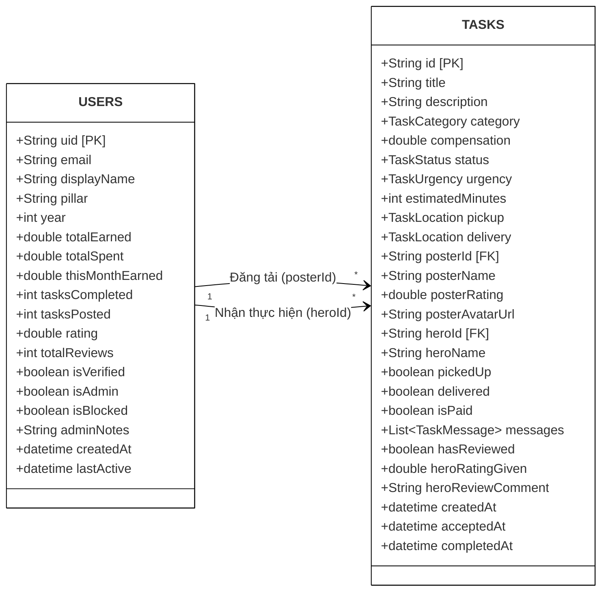

# CHƯƠNG 3: THIẾT KẾ HỆ THỐNG

## 3.1. Thiết kế Dữ liệu (Cấu trúc Collection Firebase)

Hệ thống TaskHero sử dụng cơ sở dữ liệu **Cloud Firestore (NoSQL)**. Cấu trúc dữ liệu bao gồm 2 Collection cốt lõi là `users` và `tasks`.

Dưới đây là sơ đồ mô hình hóa cấu trúc Document dưới dạng Sơ đồ Lớp (Class Diagram) để minh họa trực quan các trường dữ liệu và mối quan hệ bóc tách.

### Từ điển Dữ liệu (Data Dictionary)

Để triển khai lưu trữ trong Firestore, các thuộc tính được thiết kế cụ thể như sau:

**Bảng `USERS` (Lưu thông tin hồ sơ sinh viên)**

| Trường dữ liệu | Kiểu dữ liệu | Khóa | Ý nghĩa / Ghi chú |
| :--- | :--- | :---: | :--- |
| `uid` | String | **PK** | Mã định danh gốc do Firebase Auth cấp. |
| `email` | String | | Email sinh viên (VD: student@phenikaa-uni.edu.vn hoặc Gmail). |
| `displayName` | String | | Họ tên đầy đủ của người dùng. |
| `pillar` | String | | Chuyên ngành học (ICT-VJ, EEE-AI, MEM1, MSE1, VEE1...). |
| `year` | Integer | | Năm học của sinh viên (1 đến 5). |
| `totalEarned` | Double | | Tổng thu nhập tích lũy từ việc làm Hero (VNĐ). |
| `totalSpent` | Double | | Tổng chi phí đã trả cho việc đăng Task (VNĐ). |
| `thisMonthEarned` | Double | | Thu nhập tích lũy trong tháng hiện tại. |
| `tasksCompleted` | Integer | | Thống kê số nhiệm vụ đã hoàn thành tốt. |
| `tasksPosted` | Integer | | Số lượng nhiệm vụ đã đăng tải. |
| `rating` | Double | | Điểm đánh giá trung bình uy tín (1.0 - 5.0). |
| `totalReviews` | Integer | | Tổng số lượt nhận xét, đánh giá từ người dùng khác. |
| `isAdmin` | Boolean | | Đánh dấu tài khoản có quyền Quản trị viên (Admin). |
| `isBlocked` | Boolean | | Trạng thái khóa tài khoản do vi phạm nội quy nền tảng. |
| `isVerified` | Boolean | | Huy hiệu xác minh sinh viên uy tín. |
| `adminNotes` | String | | Ghi chú nghiệp vụ nội bộ của Quản trị viên. |

**Bảng `TASKS` (Lưu thông tin nhiệm vụ)**

| Trường dữ liệu | Kiểu dữ liệu | Khóa | Ý nghĩa / Ghi chú |
| :--- | :--- | :---: | :--- |
| `id` | String | **PK** | Mã định danh ngẫu nhiên (Auto-ID) của Task. |
| `title` | String | | Tiêu đề tóm tắt nhiệm vụ. |
| `description` | String | | Chi tiết yêu cầu công việc. |
| `category` | String/Enum | | Thuộc 6 danh mục (Food, Academic, Errands, Tech, Social, Marketplace). |
| `compensation` | Double | | Mức thù lao đề xuất quy ra VNĐ (Tối thiểu 5.000 ₫ - Tối đa 20.000.000 ₫). |
| `status` | String/Enum | | Trạng thái nhiệm vụ (open, accepted, inProgress, completed, cancelled). |
| `urgency` | String/Enum | | Mức độ khẩn cấp (normal, urgent, emergency). |
| `pickup` | Map/Object | | Địa điểm lấy đồ `{building, level, landmark}`. |
| `delivery` | Map/Object | | Địa điểm giao đồ `{building, level, landmark}`. |
| `posterId` | String | **FK** | Tham chiếu đến `uid` của người đăng (Poster). |
| `posterName` | String | | *Denormalization:* Tên người đăng để tăng tốc độ truy vấn đọc dữ liệu. |
| `heroId` | String | **FK** | Tham chiếu đến `uid` của người nhận (Hero). |
| `heroName` | String | | *Denormalization:* Tên Hero nhận thực hiện nhiệm vụ. |
| `pickedUp` | Boolean | | Trạng thái Hero đã đến điểm lấy / nhận hàng. |
| `delivered` | Boolean | | Trạng thái Hero đã giao đến nơi hoàn tất. |
| `isPaid` | Boolean | | Cờ xác nhận Poster đã giải phóng/thanh toán tiền thù lao cho Hero. |
| `messages` | List~Map~ | | Lịch sử tin nhắn chat trực tiếp & Thông báo biên nhận hệ thống. |
| `hasReviewed` | Boolean | | Cờ ghi nhận Poster đã gửi đánh giá sao cho Hero chưa. |
| `heroRatingGiven` | Double | | Số sao đánh giá thực tế (1.0 - 5.0). |
| `heroReviewComment` | String | | Nhận xét chi tiết về dịch vụ của Hero. |

---
