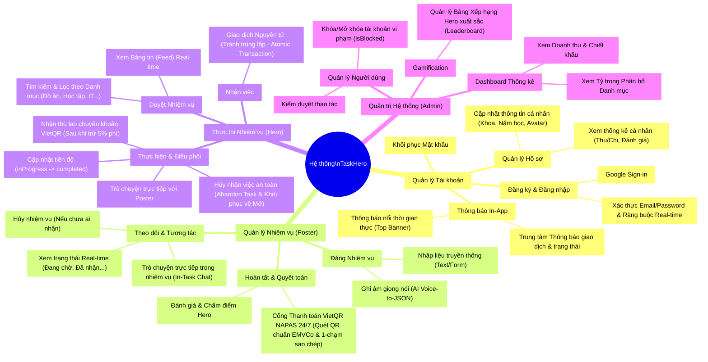

# Sơ đồ Phân rã Chức năng (Functional Decomposition Diagram - FDD)
Hệ thống Campus TaskHero

Dưới đây là Sơ đồ Phân rã Chức năng của hệ thống TaskHero được biểu diễn dưới dạng sơ đồ tư duy (Mindmap) và dạng danh sách phân cấp (Hierarchy).

## Biểu đồ Mermaid (Mindmap)
*Bạn có thể copy đoạn code này dán vào [Mermaid Live Editor](https://mermaid.live/) hoặc xem trực tiếp trên GitHub/GitLab, các trình Markdown có hỗ trợ Mermaid.*

---

## Dạng Danh sách Phân cấp (WBS - Work Breakdown Structure)

**1. Quản lý Tài khoản (Account Management)**
- 1.1 Đăng ký & Đăng nhập (Email, Google Auth) kèm Ràng buộc kiểm tra nhập liệu thời gian thực
- 1.2 Quản lý Hồ sơ (Thông tin sinh viên: Khoa, Năm học, Avatar đại diện)
- 1.3 Xem Thống kê Cá nhân (Tổng thu/chi, Số Task đã làm, Xếp hạng sao)
- 1.4 Đặt lại Mật khẩu qua Email xác thực
- 1.5 Hệ thống Thông báo nổi In-App & Trung tâm Thông báo thời gian thực

**2. Quản lý Nhiệm vụ dành cho Người đăng (Task Management for Poster)**
- 2.1 Tạo Nhiệm vụ bằng Form văn bản truyền thống (Validation số tiền, hạn chót)
- 2.2 Tạo Nhiệm vụ bằng Giọng Nói AI (Voice-to-JSON qua Deepgram + OpenAI)
- 2.3 Theo dõi Trạng thái Nhiệm vụ (Real-time qua StreamBuilder)
- 2.4 Trò chuyện trực tiếp trong nhiệm vụ (In-Task Chat & Trao đổi thông tin)
- 2.5 Hủy nhiệm vụ đã đăng (khi chưa có Hero nhận)
- 2.6 Thanh toán thù lao qua Cổng VietQR NAPAS 24/7 (Tạo mã QR chuẩn EMVCo tự động & 1-chạm sao chép số tài khoản)
- 2.7 Xác nhận hoàn thành `isPaid` & Đánh giá xếp hạng sao (Rating + Review) cho Hero

**3. Thực thi Nhiệm vụ dành cho Hero (Task Execution for Hero)**
- 3.1 Xem Bảng tin (Feed) & Duyệt / Lọc theo Danh mục (Food, Tech, Study...)
- 3.2 Nhận Nhiệm vụ (Xử lý đồng thời qua Firestore Atomic Transaction)
- 3.3 Trò chuyện trực tiếp với Người đăng trong tiến trình làm việc
- 3.4 Cập nhật tiến độ (`accepted` -> `inProgress` -> `completed`)
- 3.5 Hủy nhận việc an toàn (`abandonTask` kèm lý do & khôi phục task về trạng thái Mở cho người khác nhận)
- 3.6 Nhận tiền thù lao qua tài khoản ngân hàng (sau khi trừ 5% phí nền tảng)

**4. Quản trị Hệ thống (System Administration)**
- 4.1 Bảng điều khiển (Dashboard) Hiển thị biểu đồ luồng tiền & hoạt động
- 4.2 Quản lý Danh sách Người dùng (Xem chi tiết hồ sơ & Phân quyền)
- 4.3 Quản trị Bảo mật & Cấm tài khoản (Block users)
- 4.4 Hệ thống Thi đua Xếp hạng (Leaderboard) dành cho top sinh viên chăm chỉ
